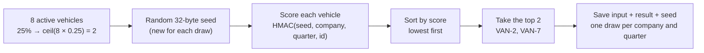

# Quarterly random vehicle selection (Part 4, Option A)

A small TypeScript library and CLI that picks a random share of a company's active vehicles for a quarter. It is fair, an auditor can reproduce it later, and it never produces a second, different selection for the same company and quarter.

**Scope:** this covers only Option A. The rate limiter (Option B) and the wider platform are not built.

## Quick start

Requirements: **Node 22.12+, 24 or 26**, and npm. Nothing else; the database is SQLite, embedded through `better-sqlite3`.

```bash
npm ci              # install (npm may warn about install scripts; this is harmless)
npm test            # 131 tests, takes about 15 seconds
npm run typecheck
npm run demo        # draws 20 vehicles, restarts, retries, then verifies an audit export
npm run benchmark   # times 20 and 200,000 vehicles
npm run fairness    # 100,000 draws: shows every vehicle is picked equally often
```

The demo prints the selected IDs twice, before and after a restart (they are the same), followed by a verification report with `"ok": true`.

## How the brief maps to the code

| Requirement from the brief | How it is met | Where |
|---|---|---|
| Input: active vehicles, percentage, quarter | Validated input object; the caller supplies the active vehicle IDs | `src/validation.ts` |
| Every eligible vehicle has an equal chance | A fresh random 32-byte seed gives every vehicle a random score (HMAC-SHA-256); the lowest scores win | `src/selection.ts` |
| An auditor can reproduce the result | Each draw stores its full input and its seed. `audit` exports them and `verify` recomputes the result | `src/audit.ts` |
| Last quarter's picks are still eligible | Nothing is excluded; every quarter is an independent draw | — |
| Running twice gives no second selection | One database row per (company, quarter). A retry returns the stored draw and never draws again | `src/service.ts`, `src/store.ts` |
| Works for 20 and 200,000 vehicles | Both are tested; 200,000 takes about 1–4 s on a laptop | `test/scale.test.ts` |

## How it works

1. **Validate** the input, then sort vehicle IDs so their order doesn't matter.
2. If a draw **already exists** for this company and quarter, return it with `reused: true`.
3. Otherwise **generate a random seed**, score each vehicle as `HMAC(seed, [company, quarter, vehicleId])`, sort by score and take the first `ceil(count × percentage)`.
4. **Save** the draw (input, result and encrypted seed) in one transaction. If two processes race, the database keeps one and both callers get that one.
5. **Audit:** `audit` exports the record with its seed. `verify` recomputes the selection from that file and checks that it matches. No key or database is needed for this step.

### Worked example: 8 vehicles at 25%



With a demo seed (`00…01`), each vehicle gets these scores (first 8 hex characters shown):

| Rank | Vehicle | Score | Selected? |
|---:|---|---|---|
| 1 | VAN-2 | `0272759b…` | ✅ |
| 2 | VAN-7 | `0cd9ae75…` | ✅ |
| 3 | VAN-3 | `301990b4…` | |
| 4 | VAN-5 | `679a6a33…` | |
| 5 | VAN-6 | `945a22ad…` | |
| 6 | VAN-1 | `b617e4ef…` | |
| 7 | VAN-4 | `b8a74016…` | |
| 8 | VAN-8 | `bc00ccda…` | |

A different seed gives completely different scores, and so a different pair. The same seed always gives the same scores, which is what lets an auditor replay the draw.

### Why every vehicle has the same chance

- **The score knows nothing useful about the vehicle.** HMAC output looks like a random number. A vehicle's ID, its position in the list and whether it was picked last quarter can't push its score up or down.
- **Every vehicle is scored the same way** with the same seed. No vehicle gets special treatment.
- **So the sorted order is a random shuffle.** Every order of the 8 vehicles is equally likely, so each vehicle has the same 2-in-8 (25%) chance of landing in the top 2.
- **Input order doesn't matter.** IDs are sorted before scoring, so listing the fleet differently can't change the result.

You can check this yourself. `npm run fairness` runs 100,000 independent draws of these 8 vehicles and counts how often each was picked. The expected count is 25,000 each:

| Vehicle | VAN-1 | VAN-2 | VAN-3 | VAN-4 | VAN-5 | VAN-6 | VAN-7 | VAN-8 |
|---|---:|---:|---:|---:|---:|---:|---:|---:|
| Times picked | 25,001 | 24,964 | 24,976 | 24,778 | 24,992 | 25,228 | 25,140 | 24,921 |

Every vehicle is within 1% of 25,000, which is ordinary random variation at this sample size. Your numbers will differ slightly each run.

Note that rounding up means the real chance is `selected ÷ fleet size`. For example, 7 vehicles at 25% selects 2, so each has a 2-in-7 (about 29%) chance. That is still equal for every vehicle.

Why a random seed rather than a hash of the inputs: if the selection depended only on the inputs, anyone could predict which vehicles will be picked. The seed keeps the selection unpredictable until the audit export reveals it.

## Using the CLI

You need a 32-byte key to encrypt the stored seeds. Create it once and **keep it**, because the stored draws can't be read without it:

```bash
export FLEETCHECK_SEED_KEY="$(node -e 'process.stdout.write(require("node:crypto").randomBytes(32).toString("base64"))')"

npm run cli -- draw --db ./draws.sqlite --input examples/draw-input.json   # first run: new draw
npm run cli -- draw --db ./draws.sqlite --input examples/draw-input.json   # second run: same draw, "reused": true
npm run cli -- get  --db ./draws.sqlite --company co-1 --quarter 2026-Q4

node --import tsx src/cli.ts audit --db ./draws.sqlite --company co-1 --quarter 2026-Q4 > audit.json
npm run verify -- audit.json                                              # "ok": true
```

Exit codes: `0` success, `1` failure (invalid data, wrong key, draw not found), `2` usage error or unreadable JSON.

### Library

```typescript
import { openSelectionService, verifyAuditBundle } from './src/index';

const service = openSelectionService({ databasePath: './draws.sqlite', encryptionKey: key });
const { record, reused, inputsMatch } = await service.createOrGet({
  companyId: 'co-1', quarter: '2026-Q4', percentage: 25,
  vehicleIds: ['v-1', 'v-2', 'v-3', 'v-4'],
});
const report = verifyAuditBundle(await service.exportAudit('co-1', '2026-Q4'));
await service.close();
```

## Input rules

- **Vehicle IDs:** non-empty strings with no duplicates. Order doesn't matter, and IDs are case-sensitive.
- **Quarter:** `YYYY-Q1` to `YYYY-Q4`.
- **Percentage:** 0.01 to 100, with at most 2 decimal places.
- **Number selected:** `ceil(vehicles × percentage)`, rounded up so that any non-empty fleet gets at least one vehicle checked. For example, 7 vehicles at 25% selects 2, and 20 vehicles at 1% selects 1. An empty fleet selects 0.

## Complexity

With *n* vehicles and *k* selected:

- **Time: O(n log n)**, from one HMAC per vehicle followed by a sort. Retries and verification replay the draw, so they cost the same.
- **Space: O(n)**, because the full list of eligible vehicles is stored with each draw so an auditor can replay it.

Measured on an Apple M1 Pro, one run each (full logs in [evidence/VERIFICATION.md](evidence/VERIFICATION.md)):

| Node | Vehicles | Create | Retry after restart | Verify audit | Peak memory |
|---|---:|---:|---:|---:|---:|
| 22 | 20 | 3 ms | 2 ms | 0.2 ms | 82 MiB |
| 22 | 200,000 | 1.2 s | 0.6 s | 0.5 s | 369 MiB |
| 24 | 20 | 3 ms | 1 ms | 0.2 ms | 82 MiB |
| 24 | 200,000 | 4.2 s | 1.9 s | 2.0 s | 485 MiB |

Peak memory is the whole Node process, including SQLite and the test data, not just the algorithm.

## Exact replay encoding (for auditors)

An auditor can recompute a draw in any language from the exported audit file:

1. Sort `eligibleVehicleIds` by UTF-16 code units. This is JavaScript's default `<`; in other languages, compare UTF-16 code units, not code points.
2. Decode `revealedSeed` from 64 hex characters into 32 bytes. That is the HMAC key.
3. For each vehicle, compute `HMAC-SHA-256(key, utf8(JSON))` where the JSON is compact with no spaces: `["v2","<companyId>","<quarter>","<vehicleId>"]`. Write each score as lowercase hex.
4. Sort by score, then by vehicle ID, and take the first `ceil(n × basisPoints / 10000)`, where basis points = percentage × 100.
5. Check: `snapshotSha256` = SHA-256 of the compact JSON array of sorted IDs; `commitment` = SHA-256 of the 32 seed bytes.

A worked fixture you can check against, calculated independently in Python: company `co-1`, quarter `2026-Q4`, 50% of `[veh-a, veh-b, veh-c, veh-d]` with seed `000102…1e1f` selects `veh-c` then `veh-b`. The full values are in `test/selection.test.ts` and [docs/PLAN.md](docs/PLAN.md#independent-fixture).

## Edge case the brief doesn't mention

**The fleet changes between the first run and a retry.** For example, a vehicle is added after the draw. The service still returns the original draw and never redraws, but marks it `inputsMatch: false` so the caller can see the input differs. Listing the same IDs in a different order still gives `inputsMatch: true`.

## Known limits and later work

These are intentionally out of scope for this exercise:

- **Future quarters are accepted.** A draw for `2030-Q1` can be made today with today's fleet. Later: only allow the current quarter, or a configurable window.
- **The seed commitment isn't published.** An auditor can confirm the draw is internally consistent, but not that it wasn't redone. Later: publish the seed hash before the quarter starts.
- **Every read replays the draw.** `get` and retries decrypt the seed and recompute the selection as an integrity check. That costs about 0.5–2 s at 200,000 vehicles and needs the key. Later: run that check on audit only.
- **Losing the key** makes stored draws unreadable. Later: key backup and rotation.
- **Single-host storage.** SQLite is safe for several processes on one machine. In production the same store interface would sit on PostgreSQL.
- **The `v1` algorithm** in `selection.ts`/`audit.ts` is a replay-only format kept from an earlier prototype, so the verifier can check older audit files. New draws always use `v2`. Later: remove it if no v1 files need verifying.

## Code design

- **Single responsibility:** each file does one job (see the layout below). `selection.ts` is pure, with no I/O, so the algorithm can be tested and replayed on its own.
- **Dependency inversion:** `DefaultSelectionService` depends on two interfaces, `SelectionStore` and `SeedCipher`, not on SQLite or AES. `openSelectionService` is the factory that plugs in the defaults. A PostgreSQL store would implement `SelectionStore` with no service changes.
- **Open/closed (strategy pattern):** each algorithm version is a `ScoringAlgorithm` entry in `algorithm.ts`. Adding a version means adding an entry; the selection code doesn't change.
- **Type safety:** strict TypeScript with no `any`, no `as` casts and no `!` assertions in `src`. Untrusted data (JSON files, database rows, IPC messages) arrives as `unknown` and is narrowed by type guards and parsers.
- **Error handling:** every deliberate error extends `SelectionError` with a `code` (`INVALID_INPUT`, `STORAGE`, `KEY`, `NOT_FOUND`). Messages are safe to show and never contain seeds, keys or raw SQLite text; the original error is kept in `cause`. The CLI maps errors to exit codes in one place.

## Project layout

```
src/
  algorithm.ts   versioned scoring strategies (v2 current, v1 replay-only)
  selection.ts   pure selection: scoring, sorting, count rule (no I/O)
  validation.ts  input validation and type guards
  record.ts      parses untrusted stored or exported records into typed records
  service.ts     createOrGet / get / exportAudit, plus the openSelectionService factory
  store.ts       SelectionStore interface and its SQLite implementation
  crypto.ts      SeedCipher interface and its AES-256-GCM implementation
  audit.ts       audit bundle creation and verification
  errors.ts      one SelectionError base class with a typed code
  cli.ts         command line wrapper
test/            unit, concurrency, crash-recovery, CLI and scale tests
scripts/         demo, benchmark and fairness check
docs/PLAN.md     the plan this was built from, with a delivery cross-check
docs/REQUIREMENTS.md  acceptance matrix written before implementation
evidence/        recorded test, benchmark and clean-install logs (see VERIFICATION.md)
```
