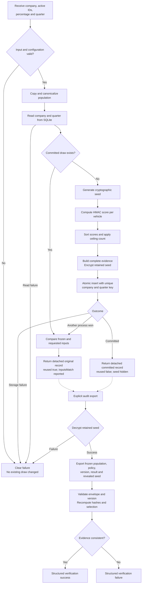

# Quarterly Random Selection From Requirements to Full Delivery

## 1. Objective and implementation boundary

Build Part 4 **Option A** as a standalone TypeScript package:

- Accept a company’s active vehicle IDs, percentage and quarter.
- Select the required number with equal treatment of eligible vehicles.
- Retain one selection per company and quarter.
- Allow an auditor to reproduce the original selection.
- Keep previous-quarter selections eligible.
- Support populations of 20 and 200,000 vehicles.

Deliver working code, automated tests, a runnable README, complexity analysis and one unstated edge case.

Carry forward the agreed decisions:

- HMAC ranking.
- SQLite persistence.
- Internally generated encrypted seeds.
- Percentages **0.01–100**, supporting two decimal places.
- Ceiling rounding.
- Tests at four public boundaries: selection/replay, durable creation, audit export/verification and CLI.

## 2. Requirements and decisions

### Required behavior

| Requirement | Observable acceptance |
|---|---|
| Input is company, active vehicles, percentage and quarter | The normal draw API accepts these values without requiring a caller-selected seed. |
| Eligible vehicles receive equal treatment | Every valid ID uses the same scoring construction. Input order and prior selection history provide no advantage. |
| Auditor can reproduce the result | Exported evidence contains frozen inputs, algorithm version and retained random material; replay reproduces the recorded result. |
| Last-quarter selections remain eligible | No history-based exclusion is applied. |
| Same company/quarter cannot produce another selection | Retries, changed inputs, restarts and concurrent processes preserve the first committed draw. |
| Works at both required scales | Creation, persistence, reopening, export and verification succeed at 20 and 200,000 vehicles. |

### Assumptions made explicit

- The caller supplies the active population; this package does not determine vehicle activity.
- IDs are case-sensitive strings. Reject blank IDs, duplicates and ill-formed Unicode; preserve other characters without normalization.
- Quarter format is `YYYY-Q1` through `YYYY-Q4`, with years 0001–9999.
- Select `ceil(population × basisPoints / 10,000)`.
- Zero percent is rejected under the agreed positive-percentage policy.
- A changed valid request returns the original draw with `inputsMatch: false`.
- Historical audit authenticity requires external evidence. The package verifies internal consistency and replay.

### Algorithm alternatives

| Algorithm | Advantages | Trade-offs |
|---|---|---|
| **HMAC ranking—chosen** | Simple per-vehicle evidence; reproducible without depending on supplied input order; straightforward to inspect. | Sorting costs O(n log n); retained ID tie-break has negligible theoretical bias on finite-score collisions. |
| Seeded partial Fisher–Yates | Clear idealized uniform-sampling argument; O(k) sampling after population preparation. | Requires a specified cryptographic stream and unbiased range conversion. Canonical preparation can still require sorting. |
| Reservoir sampling | Suitable for streaming populations; O(n) traversal and O(k) sampling memory. | Replay depends on stream order; full audit evidence still needs retained population storage. |
| Public deterministic hash | Easy replay without secret random material. | Predictable and potentially steerable; unsuitable for surprise selection. |

Choose HMAC ranking for its concise replay contract and suitability at the required scale. Document the pseudorandom-score assumption and tie limitation. Distribution tests detect gross mistakes; they do not prove fairness or honest seed selection.

## 3. Architecture and complete workflow

Use five small components:

- **Selection:** validation, canonical population, count policy and pure HMAC calculation.
- **Service:** create-or-get behavior and detached public records.
- **SQLite store:** atomic uniqueness and persistence.
- **Audit:** explicit seed disclosure, versioned evidence and verification.
- **CLI:** draw, read, export and verify commands.

### Public interfaces

```typescript
interface DrawInput {
  companyId: string;
  quarter: string;
  percentage: number;
  vehicleIds: readonly string[];
}

interface RunOutcome {
  record: SelectionRunRecord; // No plaintext seed or encryption key
  reused: boolean;
  inputsMatch: boolean;
}

interface SelectionService {
  createOrGet(input: DrawInput): Promise<RunOutcome>;
  get(companyId: string, quarter: string):
    Promise<SelectionRunRecord | undefined>;
  exportAudit(companyId: string, quarter: string):
    Promise<AuditBundle>;
  close(): Promise<void>;
}
```

Provide pure `replaySelection(input, seedHex, algorithmVersion)` and `verifyAuditBundle(unknown)` functions. Verification returns `{ ok, checks, errors }`.

Initialize the service with a database path and encryption key. A missing run returns `undefined` from `get`; exporting it returns a clear not-found error.



### Persistence and seed contract

Use `better-sqlite3` 13.0.3 with Node 22+, WAL, full synchronous commits and a five-second busy timeout.

The SQLite record contains:

- Company and quarter as a composite primary key.
- Complete frozen public record.
- Encrypted seed, nonce and authentication tag.
- Schema version.

Compute candidates outside the write transaction. Atomically insert the complete record if absent, then return the committed winner. No successful result is exposed before commit.

Generate 32 random seed bytes. Encrypt using AES-256-GCM with a fresh 12-byte nonce and authenticated additional data containing algorithm version, company and quarter. Keep the encryption key outside SQLite; the CLI reads base64 `FLEETCHECK_SEED_KEY`.

New records use algorithm **v2**:

- Decode the 64-character hexadecimal seed before HMAC.
- Encode each message as compact UTF-8 JSON `[version, companyId, quarter, vehicleId]`.
- Canonicalize IDs using code-unit ordering.
- Rank ascending by score, then ID.
- Snapshot hash: SHA-256 of the compact canonical ID array.
- Commitment: SHA-256 of decoded seed bytes.

Retain explicit v1 replay support for reference fixtures, but create only v2 draws. Reject unknown versions. Algorithm description text is informational.

## 4. Acceptance scenarios defined before code

Every feature needs both success and failure coverage. Failure tests assert the error, preserved state, absence of false success and absence of secret leakage.

| Area | Success scenarios | Failure and recovery scenarios |
|---|---|---|
| Inputs | Valid company, population, percentage and quarter. | Missing/wrong types, non-array population, blank/duplicate IDs, malformed Unicode and caller-supplied orchestration seed rejected. |
| Percentages | Accept 0.01, 0.07, 12.5, 25 and 100. | Reject zero, negatives, above 100, nonfinite values, 0.001, `1e-12` and 12.345. |
| Counts | 20 at 25% → 5; 7 at 25% → 2; 20 at 1% → 1; one at 0.01% → one; empty → zero; 100% → all. | Empty populations cannot bypass validation; inconsistent or duplicate selected members fail verification. |
| Encoding | Unicode, quotes and delimiters remain distinct; caller arrays remain unchanged. | Lone surrogates rejected; input or returned-object mutation cannot alter frozen evidence. |
| Replay | Identical explicit inputs reproduce exactly; reversing/shuffling IDs changes nothing. | Altered evidence and unsupported versions fail. |
| Previous selection | A fixed previous-quarter pick remains eligible; subsequent 100% draw includes it. | No historical exclusion reduces the supplied population. |
| Distribution | Twenty vehicles at 25% over 4,000 fixed seeds; counts within five binomial standard deviations of 1,000. | Gross bias fails; passing is not presented as proof. |
| Creation/retry | One creation; identical retry returns original with matching inputs. | Changed valid inputs return original with mismatch; invalid retry rejected without mutation. |
| Restart | Close/reopen and another process retrieve the original. | Storage failure does not trigger an in-memory fallback or replacement draw. |
| Concurrency | Ten independent processes yield one creator and the same committed record. | Conflicting candidates cannot overwrite the winner or return discarded selections. |
| Interruption | Commit survives process termination. | Reopening finds no draw or one complete draw, never partial evidence; retry is safe. |
| Contention | Success when contention clears within five seconds. | Timeout returns retryable failure with unchanged existing data. |
| Seed/export | Correct key exports retained seed after restart. | Wrong/malformed key, modified ciphertext or moved encrypted seed fails; never regenerate. |
| At-rest security | Plaintext seed/key absent from persisted artifacts and ordinary output. | Plaintext persistence or secret-bearing errors fail acceptance. |
| Audit envelope | Valid evidence returns structured success. | Null, primitives, malformed fields and tampered identity/policy/selection return structured failure without crashing. |
| CLI | Draw, reopen, export and verification work from documented commands. | Valid verification exits 0; invalid evidence/operational errors exit 1; usage/unreadable files/invalid JSON syntax exit 2. |
| Scale | Complete lifecycle at 20 and 200,000; larger 25% draw selects 50,000 unique IDs. | Large-population restart, changed-input retry and tampering retain the same protections. |

Different seeds or run identities may legitimately produce overlapping selections. Do not require every change to produce different selected IDs.

### Independent fixture

Use this literal fixture, independently calculated with Python HMAC/SHA-256:

```text
companyId: co-1
quarter: 2026-Q4
percentage: 50
vehicleIds: [veh-a, veh-b, veh-c, veh-d]
seedHex:
000102030405060708090a0b0c0d0e0f101112131415161718191a1b1c1d1e1f

rank 1: veh-c
score:
30bbe88e5ac582976a74c9489f3b5121d4999e7bb4eec18f10395f1f137b814d

rank 2: veh-b
score:
93bc42ecaea91a3cb92afdba64829727207b479f56afb884b43af30ac14a2dda

snapshotSha256:
2ca026c39676f7ed99991435a8bce55e089452390cf8d27b81a0cb6870146a20

commitment:
630dcd2966c4336691125448bbb25b4ff412a49c732db2c8abc1b8581bd710dd
```

Distribution seeds are SHA-256 bytes of UTF-8 `distribution:<trial>`, trials 0–3,999.

## 5. Implementation stages from zero

### Stage 1 Requirements and package setup

Create the sibling package, requirements matrix, TypeScript configuration, Vitest setup, scripts and one npm lockfile. Define public types, errors and test fixtures. Confirm clean install and test discovery.

Keep the original implementation untouched; use it only to compare decisions and independently review coverage.

### Stage 2 Validation and count policy

Implement paired success/rejection cases one at a time. Each new test fails for the intended missing behavior before production code is written.

### Stage 3 Pure algorithm and replay

Start with the independent known-answer fixture. Implement v2 encoding, scoring, ranking and replay; then add order independence, membership, previous-quarter eligibility and distribution checks. Add rejection cases alongside valid behavior.

### Stage 4 Durable orchestration

Implement SQLite schema and atomic create-or-get behavior. Pair first creation with write failure, identical retry with changed-input retry, and returned records with mutation-protection tests.

### Stage 5 Seed encryption and audit

Implement internal seed generation, encrypted persistence and explicit export. Pair correct-key export with wrong-key, corrupted-ciphertext and identity-binding failures. Implement envelope/version validation and tampering checks.

### Stage 6 Restart, concurrency and recovery

Use temporary databases and independent child processes. Verify one committed winner, conflicting inputs, reopen behavior, interruptions and contention. Do not replace these tests with shared-object concurrency.

### Stage 7 CLI and scale

Implement `draw`, `get`, `audit` and `verify` commands. Pair successful commands with argument, input, storage and verification failures.

Run the complete lifecycle at both required sizes. Retain the generous 10-second pure-selection guard and separately measure creation, export, replay and memory.

### Stage 8 Documentation and final verification

Write the README, complexity note, edge-case explanation and limitations. Run all acceptance tests, type checking and documented commands from a clean installation on Node 22 and 24.

For every new behavior, retain the test name, intended red failure and green result. Tests use public boundaries; expected selections are literal independent fixtures, not values generated by the implementation under test.

## 6. Edge-case reasoning and final submission

**Featured unstated edge case:** The active fleet changes between the first call and a retry. Recalculating would create a different same-quarter selection. Frozen inputs and durable uniqueness preserve the original, while mismatch reporting exposes the changed request.

Other handled cases:

- Fractional counts: explicit ceiling policy avoids ambiguous rounding.
- Concurrent callers: atomic uniqueness chooses one complete winner.
- Lost response after commit: retry reads the original draw.
- Missing encryption key: explicit recovery failure prevents an invalid replacement.
- Mutated returned objects: detached records protect frozen evidence.
- Malformed/tampered bundles: validation rejects unsupported or inconsistent evidence.

**Kept out:** Vehicle lifecycle and activity verification, scheduling/cutoff policy, tenant authorization, cloud deployment, regulator portals, public randomness beacons, production key rotation and independent historical issuance authentication.

The README must state:

- Exact installation, test, typecheck, demo and replay commands.
- Input, rounding, encoding and seed-recovery contracts.
- **Time complexity:** O(n log n).
- **Space complexity:** O(n), including retained population evidence.
- Measured runtime/environment, timing and memory scope.
- The changed-fleet retry edge case and its solution.
- Fairness assumptions and audit limitations.

The deliverable is complete only when working code, success/failure/recovery tests, clean-install commands, scale evidence and the README satisfy this checklist. This planning stage leaves the existing code unchanged.

---

## Delivery cross-check (added after implementation)

This section was added after the build, checking each part of the plan above against the delivered code. Everything above it is the original plan, unchanged.

| Plan item | Status | Where |
|---|---|---|
| Accept company, active IDs, percentage, quarter; no caller seed | ✅ Done | `src/domain/validation.ts` |
| HMAC ranking, v2 encoding, code-unit ordering, score-then-ID ranking | ✅ Done | `src/domain/selection.ts` |
| Ceiling count; 0.01–100%, two decimals; zero rejected | ✅ Done | `src/domain/validation.ts`, `test/selection.test.ts` |
| SQLite: composite key, WAL, full sync, 5 s busy timeout, atomic insert | ✅ Done | `src/infrastructure/persistence/sqlite-selection-store.ts` |
| AES-256-GCM seed, fresh 12-byte nonce, version/company/quarter bound as AAD | ✅ Done | `src/infrastructure/crypto/aes-gcm-seed-cipher.ts` |
| Changed valid request returns original with `inputsMatch: false` | ✅ Done | `src/application/default-selection-service.ts`, `test/service.test.ts` |
| v1 replay only; new draws v2; unknown versions rejected | ✅ Done | `src/domain/algorithms/` |
| Independent fixture: ranks, scores, snapshot hash | ✅ Tested | `test/selection.test.ts` |
| Independent fixture: commitment hash | ✅ Tested (assertion added during this cross-check) | `test/selection.test.ts` |
| Distribution: 4,000 seeds from `distribution:<trial>`, within 5 standard deviations | ✅ Tested | `test/selection.test.ts` |
| Previous-quarter pick stays eligible | ✅ Tested | `test/selection.test.ts` |
| Ten independent processes, conflicting inputs, kill/restart, contention, rollback | ✅ Tested | `test/recovery.test.ts` |
| Wrong key, tampered ciphertext, moved seed, no plaintext at rest | ✅ Tested | `test/seed.test.ts` |
| Tampered and malformed audit bundles | ✅ Tested | `test/audit.test.ts` |
| CLI `draw`/`get`/`audit`/`verify`, exit codes 0/1/2 | ✅ Tested | `test/cli.test.ts` |
| 20 and 200,000 lifecycle; 50,000 unique at 25%; 10 s pure-selection guard | ✅ Tested | `test/scale.test.ts`, `scripts/benchmark.ts` |
| README: commands, input and rounding rules, replay encoding, complexity, measurements, edge case, limits | ✅ Done | `README.md` |
| Clean install and full verification on Node 22 and 24 | ✅ Done | `evidence/VERIFICATION.md` |

### Differences from the plan

- **Node 26 is also supported.** The plan targeted Node 22 and 24. Node 26 was added after a clean install on it was refused; tests, typecheck and demo pass on it.
- **A fairness script was added** (`npm run fairness`). It is not in the plan: it runs 100,000 draws so a reader can see equal pick rates. Like the 4,000-seed test, it detects gross bias and is not a proof.
- **The commitment hash in the fixture** was listed in the plan but not asserted by a test. That assertion was added during this cross-check.

### Left for later (also listed in the README)

Future quarters are accepted; the seed commitment isn't published before the quarter; every read replays the draw; key backup and rotation; multi-host storage (PostgreSQL); removing v1 if no older audit files need verifying.
